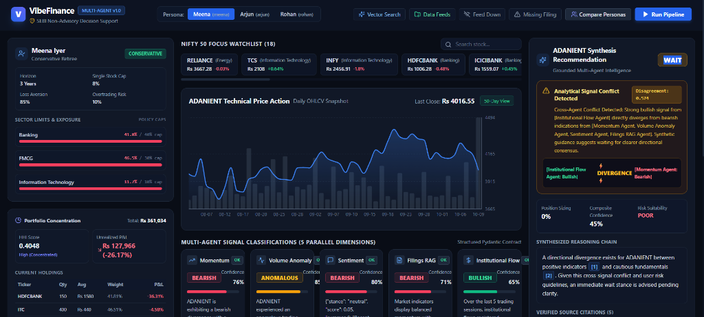
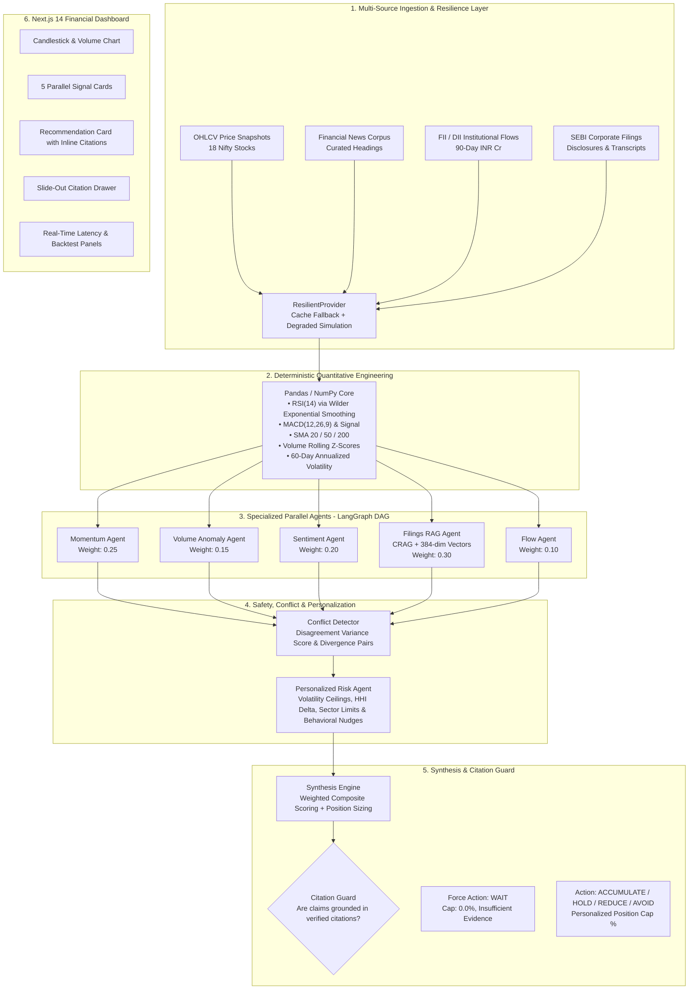
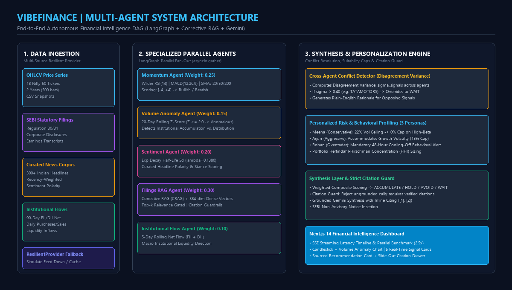

<div align="center">

# ⚡ VibeFinance
### Multi-Agent Autonomous Financial Intelligence for Retail Investors

[](https://github.com/your-username/vibefinance)
[](https://github.com/your-username/vibefinance)
[](https://nextjs.org/)
[](https://fastapi.tiangolo.com/)
[](https://langchain-ai.github.io/langgraph/)
[](https://deepmind.google/technologies/gemini/)
[](https://modelcontextprotocol.io/)
[](https://opensource.org/licenses/MIT)

**Official Problem Statement 04 Solution**
*Converting continuous market data, regulatory filings, and behavioral signals into personalized, explainable, and cited financial intelligence for Indian retail investors across 18 Nifty 50 bellwethers.*

[📑 Read Hackathon Submission Dossier](./HACKATHON_SUBMISSION.md) • [📕 Download PDF Dossier](./VibeFinance_PS04_Dossier.pdf) • [🏛 Architecture Specs](./docs/ARCHITECTURE.md) • [📊 Data Assumptions](./docs/DATA_ASSUMPTIONS.md)

<br/><br/>



</div>

---

## 🌟 Executive Overview

India's retail investment ecosystem has access to vast amounts of market information: NSE price feeds, SEBI corporate filings, FII/DII institutional flows, earnings call transcripts, and breaking financial news. However, retail investors face an acute **information asymmetry and synthesis barrier**:

- **Fragmented Tools**: Screeners detect momentum, news aggregators push alerts, and portfolio apps log holdings—none synthesize them together.
- **Institutional Scale Gap**: Retail investors lack the research infrastructure to read 50-page regulatory disclosures, compute institutional liquidity shifts, or verify whether price rallies contradict corporate debt or pledge filings.
- **Generic Recommendations**: Most retail tools output one-size-fits-all calls without evaluating an investor's personal risk tolerance, portfolio concentration (HHI), or emotional behavioral patterns (e.g. panic selling or high-frequency overtrading).

**VibeFinance** solves this with a **deterministic quantitative core** orchestrated by a **LangGraph multi-agent DAG**, a **Corrective RAG (CRAG)** engine powered by 384-dimensional dense semantic vectors, and **Google Gemini Flash** synthesis. Every recommendation includes **transparent mathematical reasoning, verified source attribution, position sizing, and confidence calibration**.

---

## 🏗️ System Architecture



<p align="center">
  
</p>

---

## 🚀 Key Features & PS 04 Compliance

### 1. Multi-Dimensional Signal Classification
- **Price Momentum Agent**: Evaluates 14-day Wilder RSI, MACD histogram velocity, and SMA 20/50/200 trend alignment on a $[-4, +4]$ scoring scale.
- **Volume Anomaly Agent**: Detects institutional participation using rolling 20-day volume Z-scores ($Z \ge 2.0$), identifying accumulation vs. distribution.
- **Sentiment Agent**: Analyzes recent financial headlines with an exponential recency half-life decay ($\lambda = 0.1386$, 5-day half-life).
- **Filings RAG Agent**: Corrective RAG over SEBI regulatory filings under Regulation 30/31 and earnings call transcripts using 384-dimensional dense semantic vectors.
- **Institutional Flow Agent**: Tracks 5-day cumulative institutional net flow $(FII + DII)$ in INR Crores.

### 2. Verified Retrieval & Citation Guard
- Every recommendation is strictly grounded in retrieved evidence. Clicking citation chips (`[1]`, `[2]`) slides out the **Citation Drawer**, showing the exact statutory text, publication date, source type, and relevance score.
- **Strict Citation Guard**: If an agent recommendation lacks source attribution, the synthesis layer automatically downgrades the action to `WAIT` with $0\%$ allocation.

### 3. Investor Personalization & Behavioral Economics
Supports three seeded investor personas demonstrating that **identical market data yields distinct, personalized outcomes**:
- **Meena Patel (Conservative Retiree, 3y Horizon)**: Strictly enforces a $22.0\%$ annualized volatility ceiling. High-beta or governance-risk stocks (e.g. `ADANIENT`) receive a **$0.0\%$ Position Cap** (`AVOID / WAIT`).
- **Arjun Mehta (Aggressive Growth, 10y Horizon)**: Accommodates equity volatility for long-term compound growth (up to $15\%$ single-stock cap).
- **Rohan Verma (High-Frequency Overtrader, 0.85 Turnover Score)**: Automatically triggers a **mandatory 48-hour cooling-off nudge** and loss-aversion alert to protect against panic selling.
- **Interactive Compare Personas Modal**: Side-by-side 3-column view evaluating identical stocks across all 3 personas simultaneously.

### 4. Cross-Agent Conflict Detection & Disagreement Variance
- Computes **Disagreement Variance** ($\sigma_{\text{signals}}$) across all active agents.
- When signals contradict (e.g., in `TATAMOTORS` where price momentum is bullish but SEBI filings reveal a 180 bps margin guidance cut), the conflict detector flags an amber warning and prudently forces action to `WAIT` with reduced confidence.

### 5. Evaluation, Backtesting & Calibration
- **18-Month Walk-Forward Simulation**: Evaluates 940 momentum signals (49.6% win rate) and 70 volume anomaly signals (54.3% win rate) against forward 30-day returns without lookahead bias.
- **Confidence Calibration**: Bins agent confidence into 5 probability buckets and compares predicted confidence against empirical 30-day win rates.
- **Parallel Latency Acceleration**: Real-time SSE latency benchmark demonstrating a **$2.5\times$ speedup** from parallel LangGraph execution vs. sequential evaluation.

### 6. Zero-Crash Fault Tolerance & Graceful Degradation
- **Simulate Feed Down**: Seamlessly switches from live to cached snapshot data with an amber warning banner.
- **Missing Regulatory Filings (`WIPRO`)**: Cleanly returns `signal='no_data'` with degraded status; analysis proceeds safely on remaining signals without crashing or hallucinating.
- **Offline / Zero-Key Execution**: Fully functional out of the box with deterministic fallbacks even without an external API key.

### 7. Model Context Protocol (MCP) Server
- Stdio JSON-RPC 2.0 MCP server exposing tools (`get_signals`, `search_filings`, `get_portfolio`, `analyze`) for Claude Desktop, Cursor, or external autonomous agents.

---

## 🛠️ Complete Setup & Installation Guide

### Prerequisites
- **Python**: 3.10 or higher (3.11, 3.12, 3.14 verified)
- **Node.js**: 18.17 or higher (Node 20+ recommended)
- **npm**: 9.0 or higher
- **Git**

---

### Option A: Local Development (Fastest)

#### 1. Clone the Repository
```bash
git clone https://github.com/your-username/vibefinance.git
cd vibefinance
```

#### 2. Backend Setup
```powershell
# Windows (PowerShell):
python -m venv .venv
.venv\Scripts\activate
pip install -r requirements.txt

# Linux / macOS:
python3 -m venv .venv
source .venv/bin/activate
pip install -r requirements.txt
```

#### 3. Configure Environment Variables
```bash
# Windows:
copy .env.example .env

# Linux / macOS:
cp .env.example .env
```
*(Optional)* Add your Gemini API key in `.env`:
```env
GEMINI_API_KEY=your_gemini_api_key_here
LLM_PROVIDER=gemini
APP_ENV=development
```
*Note: If no API key is provided, the system automatically uses its built-in deterministic rule engine with 100% test passage.*

#### 4. Run Automated Verification Tests
```bash
# Run all 21 pytest suites:
pytest tests/ -v

# Run the 20-point End-to-End integration audit script:
python scripts/verify_e2e.py
```
*Expected: 21 / 21 pytest passed, 20 / 20 E2E checks passed (100.0%).*

#### 5. Launch FastAPI Backend Daemon
```bash
python -m uvicorn backend.app.main:app --host 127.0.0.1 --port 8000 --reload
```
- API Health: [http://127.0.0.1:8000/api/health](http://127.0.0.1:8000/api/health)
- OpenAPI Docs: [http://127.0.0.1:8000/docs](http://127.0.0.1:8000/docs)

#### 6. Launch Next.js Frontend
In a new terminal window:
```bash
cd frontend
npm install
npm run dev
```
Open **[http://localhost:3000](http://localhost:3000)** in your browser.

---

### Option B: Docker Compose Deployment

Run both backend and frontend inside containers with one command:
```bash
docker compose up --build
```
- Frontend Dashboard: [http://localhost:3000](http://localhost:3000)
- Backend API: [http://localhost:8000](http://localhost:8000)
- API Documentation: [http://localhost:8000/docs](http://localhost:8000/docs)

---

### Option C: Running the MCP Server

VibeFinance includes a standard Model Context Protocol (MCP) server for integration with Cursor, Claude Desktop, or custom agent swarms.

#### Test via Stdio:
```bash
python backend/mcp_server.py
```

#### Connect to Claude Desktop (`claude_desktop_config.json`):
```json
{
  "mcpServers": {
    "vibefinance": {
      "command": "python",
      "args": ["d:/python/projects/folder/backend/mcp_server.py"],
      "env": {
        "PYTHONPATH": "d:/python/projects/folder"
      }
    }
  }
}
```

---

## 🎯 5-Minute Judge Demo Script

| Step | Action | What Judges Observe | PS 04 Requirement Demonstrated |
| :---: | :--- | :--- | :--- |
| **1** | Select **Meena** (Conservative) and choose **`ADANIENT`** | Volume Anomaly is **Anomalous** ($Z=5.76$). Filings RAG is **Bearish** (pledge increase $12\% \to 19\%$). Click citation **`[1]`** to slide out the **Citation Drawer**. Recommendation is **`AVOID / WAIT`** (Cap $0\%$). | Multi-dimensional signals, RAG source attribution, and risk-adjusted position sizing. |
| **2** | Click **"Compare Personas"** in the top bar | 3-column modal: Meena gets $0\%$ cap; Arjun accommodates growth risk; Rohan receives a **48-Hour Cooling-Off Behavioral Alert**. | Personalized investor profiling & behavioral economics. |
| **3** | Select **`TATAMOTORS`** | Momentum is **Bullish**, but Filings RAG is **Bearish** (180 bps margin cut). Conflict Detector fires an amber banner ($\sigma = 0.504$), forcing action to **`WAIT`**. | Conflict detection & disagreement variance handling. |
| **4** | Toggle **"Simulate Feed Down"**, then select **`WIPRO`** | Feed down smoothly switches to cached snapshot with warning banner. `WIPRO` (0 filings) outputs clean `NO DATA` without crashing. | Graceful degradation under missing or failing feeds. |
| **5** | Inspect Bottom Panels | Review **SSE Execution Timeline**, **Parallel Latency Speedup** ($2.5\times$ faster), **18-Month Backtest Win Rates**, and **Confidence Calibration Curve**. | Performance metrics, parallel benchmarking, and calibration. |

---

## 📊 Evaluation & Verification Summary

```
======================================================================
VIBEFINANCE (PS 04) END-TO-END VERIFICATION AUDIT
======================================================================
[PASSED] Check 1: Next.js Frontend is Running & Healthy
[PASSED] Check 2: Backend API Health Check
[PASSED] Check 3: Watchlist Universe Contains 18 Nifty 50 Stocks
[PASSED] Check 4: OHLCV Candlestick Feed for Charting
[PASSED] Check 5: Conservative Persona (Meena) Profile
[PASSED] Check 6: Aggressive Persona (Arjun) Profile
[PASSED] Check 7: Overtrader Persona (Rohan) Profile
[PASSED] Check 8: Portfolio Valuation & HHI Concentration
[PASSED] Check 9: ADANIENT Analysis for Meena (Conservative)
[PASSED] Check 10: ADANIENT Analysis for Arjun (Aggressive)
[PASSED] Check 11: Rohan Behavioral Cooling-off Nudge Triggered
[PASSED] Check 12: Recommendation Grounded in Regulatory Filings
[PASSED] Check 13: Citation Drawer Document Chunk Retrieval
[PASSED] Check 14: Planted Volume Anomaly Detected on ADANIENT
[PASSED] Check 15: TATAMOTORS Cross-Agent Conflict Detected
[PASSED] Check 16: Graceful Handling of Down Price Feed
[PASSED] Check 17: Graceful Handling of Missing Filing (WIPRO)
[PASSED] Check 18: Measurable Session Metrics Captured (>= 3 Metrics)
[PASSED] Check 19: 18-Month Historical Backtesting Suite
[PASSED] Check 20: Mandatory SEBI Research Analyst Disclaimer Present
======================================================================
VERIFICATION SUMMARY: 20 / 20 CHECKS PASSED (100.0%)
======================================================================
```

---

## 📁 Repository Structure

```
vibefinance/
├── backend/
│   ├── app/
│   │   ├── agents/             # Momentum, Volume, Sentiment, Filings RAG, Flow, Conflict, Risk, Synthesis
│   │   ├── api/                # REST & SSE Endpoints (Stocks, Analyze, Profile, Documents, Metrics)
│   │   ├── data/               # Ingestion Layer (Cached, Live, ResilientProvider)
│   │   ├── eval/               # 18-Month Backtest & Confidence Calibration
│   │   ├── features/           # Deterministic Math (RSI, MACD, SMAs, Z-Scores, HHI)
│   │   ├── graph/              # LangGraph DAG & Runner with SSE streaming
│   │   ├── rag/                # Chunker & 384-dim Dense Semantic Vector Search
│   │   └── schemas/            # Strict Pydantic Contracts (AgentOutput, Evidence, AnalysisResponse)
│   └── mcp_server.py           # Model Context Protocol stdio server
├── frontend/                   # Next.js 14 Financial Intelligence Terminal
│   ├── app/                    # Layout, styling & dashboard pages
│   ├── components/             # Recharts Candlesticks, SignalCards, CitationDrawer, Modals
│   └── lib/                    # Typed API client & contracts
├── data_snapshot/              # 100% self-contained demo snapshot dataset (18 stocks)
├── docs/                       # Architecture diagrams & data assumptions
├── scripts/                    # 20-point verify_e2e.py audit script
├── tests/                      # 21 automated pytest test suites
├── docker-compose.yml          # Full-stack container deployment
├── Dockerfile.backend
├── requirements.txt
├── HACKATHON_SUBMISSION.md     # Comprehensive hackathon submission dossier
└── README.md                   # This file
```

---

## ⚖️ Regulatory Notice & SEBI Disclaimer

*VibeFinance is an educational and algorithmic research platform. In compliance with SEBI (Research Analysts) Regulations, 2014, outputs generated are decision-support models and do not constitute personalized financial advice, investment advisory, or a recommendation to buy or sell securities. Retail investors should perform independent due diligence or consult a SEBI-registered Investment Adviser before allocating capital.*
